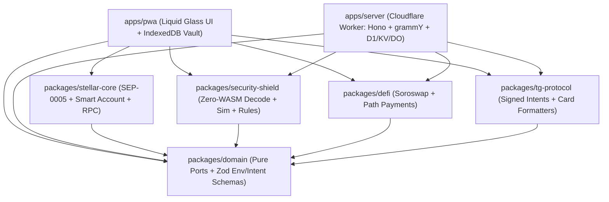
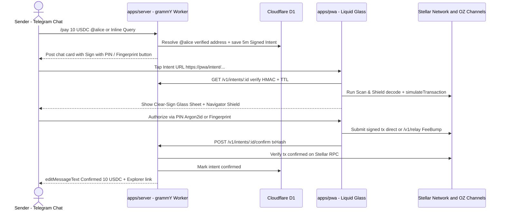

# AstroWallet — Modular System Architecture

## 1. Architectural Principles

1. **Zero-PC, Phone-First Universal Ergonomics:** Every workflow—SEP-0005 seed generation, multi-account management, Fingerprint/PIN signing, P2P transfers, QR scanning, Soroswap swaps, and recovery—runs cleanly on any modern or mid-range smartphone without desktop extensions, CLI tools, or FaceID-specific hardware.
2. **Hexagonal Monorepo Boundaries:** Pure domain models, cryptographic custody, ledger protocols, security analysis, and Telegram/PWA adapters are strictly decoupled. Neither React state, IndexedDB, nor `grammY` webhook logic may leak into `@astrowallet/domain` or ledger adapters.
3. **Honest Multi-Account Custody (`G...` Classic + Optional `C...` Smart):** One non-custodial **SEP-0005** seed phrase (`m/44'/148'/i'`) controls multiple linked Classic accounts (`G...`) and acts as the on-chain Recovery Guardian for optional **Soroban Smart Accounts (`C...`)**. Both account classes are labeled transparently with 1-tap `SAC` transfers between them.
4. **Fail-Closed "Scan & Shield" Clear-Signing:** Never display opaque Base64 XDRs. Every signing intent passes through zero-WASM decoding, Soroban simulation, reserve/memo validation, and directory threat rules before keys touch it.
5. **Genuine Telegram Super-Bot Connectivity (ToS-Compliant):** Operates purely as a standard Telegram Bot (`grammY` + Inline Mode + `InlineKeyboardButton` HTTPS Intent Links)—zero Mini App WebView, zero TON Connect dependency, and zero private keys anywhere on Telegram or backend storage.
6. **Zero-Hardcoding Production Parity:** Every network passphrase, RPC/Horizon URL, contract ID, and API base comes from Zod-validated environment configuration (`STELLAR_NETWORK=testnet|mainnet`). Switching environments requires zero code changes.

---

## 2. Consolidated Modular Monorepo Structure

```text
astrowallet/
├── packages/
│   ├── domain/                 # Pure types, Ports (SignerPort, ChainPort, ScannerPort, SwapPort),
│   │                           # Zod NetworkConfig & Intent schemas (zero DOM/network deps)
│   ├── stellar-core/           # Unified Stellar custody & ledger engine:
│   │   ├── vault/              #   Web Worker Argon2id (hash-wasm + @noble fallback), AES-GCM-256, IndexedDB
│   │   ├── classic/            #   SEP-0005 HD (m/44'/148'/i'), M... muxed, reserves, paths, claimables
│   │   ├── smart-account/      #   smart-account-kit + OpenZeppelin stellar-contracts (secp256r1 + Guardian)
│   │   └── rpc/                #   Env-driven RPC & Horizon failover + SAC bridge helpers
│   ├── security-shield/        # Reusable pre-sign pipeline (PWA + Telegram /scan):
│   │   ├── decoder/            #   Zero-WASM @stellar/stellar-sdk + contract.Spec (SEP-46/47/48)
│   │   ├── simulator/          #   simulateTransaction balance diffs & TTL auto-restore checks
│   │   ├── rules/              #   StellarExpert directory, SEP-1/29/42, local drainer AST & spam filter
│   │   └── raw-xdr-worker/     #   Lazy Web Worker for @stellar/stellar-xdr-json (~3 MB WASM on-demand only)
│   ├── defi/                   # Modular DeFi & Ramp adapters behind SwapPort / RampPort:
│   │   ├── v1/                 #   Soroswap Aggregator (via Worker proxy) + Horizon Path Payments
│   │   └── v2-plugins/         #   Circle CCTP, MoonPay/Transak, Blend, DeFindex, SEP-24 (pluggable)
│   └── tg-protocol/            # Shared Bot <-> PWA protocol:
│                               #   HMAC-signed Intent Tokens, /connect challenge verification,
│                               #   Claim Link payloads, and live Telegram card formatters
├── apps/
│   ├── pwa/                    # Mobile-first Apple Liquid Glass PWA (React + Vite + Tailwind + Astro Navigators):
│   │                           #   PIN + optional Fingerprint auth, Multi-Account Switcher, Clear-Sign Sheet,
│   │                           #   Intent Executor, QR Scanner, WalletConnect v2 / Stellar Wallets Kit
│   └── server/                 # Unified Cloudflare Worker (Hono + grammY + D1 + KV + Durable Objects):
│                               #   /tg/webhook         -> Standard + Inline Telegram Super-Bot
│                               #   /v1/intents         -> Create/verify HMAC-signed intents + edit chat cards
│                               #   /v1/relay           -> Rate-limited proxy to OpenZeppelin Channels
│                               #   /v1/proxy/*         -> Edge cache CORS proxy (StellarExpert, SEP-1, Soroswap)
│                               #   /webhooks/indexer   -> Goldsky / Mercury real-time alerts + DO RPC poller
├── contracts/                  # Minimal Soroban Claim-Link Escrow contract (Phase 2 Rust/wasm32v1-none);
│                               # Smart Accounts reuse audited OpenZeppelin stellar-contracts unmodified
└── docs/                       # DESIGN_SYSTEM.md, FEASIBILITY, BENCHMARK, CASE_STUDIES
```

### Dependency Flow Diagram



---

## 3. Core Subsystems

### A. Custody, Universal Auth & Multi-Account Topology (`stellar-core`)

All signers implement `SignerPort` (`getAddress`, `capabilities`, `signTransactionEnvelope`, `signAuthEntry`, `signMessage`):

1. **Universal Mandatory Baseline — PIN / Passphrase + Argon2id Web Worker:**
   - **Never require FaceID.** Every device unlocks local custody with a **6-digit PIN or passphrase** processed inside a dedicated Web Worker via **Argon2id (`hash-wasm`)** with automatic pure-JS fallback (**`@noble/hashes/argon2`**) when strict CSP or iOS Lockdown Mode restricts WASM.
   - Encrypted vault envelopes use **AES-GCM-256** (fresh 16-byte salt, unique 12-byte IV) stored in **IndexedDB** (`navigator.storage.persist()`), backed by non-extractable `CryptoKey` handles and explicit RAM zeroization.
2. **Optional Fingerprint / Device Biometric Convenience:**
   - Standard **WebAuthn (`userVerification: "preferred"`)** binds Touch ID, Android Fingerprint/BiometricPrompt, or device screen lock when available:
     - On `G...` vaults, feature-detected WebAuthn `prf` acts strictly as a convenience shortcut alongside the mandatory PIN (never the sole recovery factor).
     - On optional `C...` Smart Accounts, a device Passkey (`secp256r1`) acts as a fast on-chain Soroban signer.
3. **One Master Seed Phrase → Multiple Linked Accounts:**
   - **SEP-0005 HD Derivation:** A single 12/24-word BIP-39 mnemonic derives indexed Ed25519 accounts via SLIP-0010 (`m/44'/148'/0'`, `m/44'/148'/1'`, `m/44'/148'/2'`, ...), 100% compatible with LOBSTR, Varial, Ledger, and MetaMask Stellar.
   - **Optional Smart Account (`C...`) Pairing:** Uses `smart-account-kit` (`v0.10.x`) + OpenZeppelin `stellar-contracts` (`packages/accounts`). The user's seed-derived `G...` public key is registered on-chain as the **Ed25519 Recovery Guardian** in Context Rules, while Fingerprint (`secp256r1`) signs daily Soroban actions and spending-limited session keys.
   - **iOS Partitioning Mitigation:** Because iOS isolates `IndexedDB` between Safari and installed Home Screen PWAs, iOS onboarding guides **"Add to Home Screen" first** before local seed generation and provides encrypted `AGVAULT` transfer files for safe device migration.

### B. Honest `G...` vs `C...` Capability Matrix

Rather than hiding protocol differences behind leaky abstractions, AstroWallet presents both roles clearly in the UI and exposes **1-tap SAC transfers** between linked accounts:

| Capability | Classic Account (`G...` — SEP-0005) | Soroban Smart Account (`C...` — Optional) |
| :--- | :--- | :--- |
| **Seed Portability (LOBSTR/Varial/Ledger)** | Native 1:1 (`m/44'/148'/i'`) | Acts as on-chain Recovery Guardian via linked `G...` |
| **Gasless UX via OpenZeppelin Channels** | Via outer `CAP-15` `FeeBumpTransactionEnvelope` | Native via `submitSorobanTransaction` (`func` + `auth`) |
| **Classic SDEX & `pathPayment`** | Full native support | Not supported by Stellar protocol on `C...` |
| **Claimable Balances (`claimClaimableBalance`)** | Full native support | Not supported directly (route to linked `G...`) |
| **CEX Deposits & Withdrawals** | Direct `G...` + `Memo` (`SEP-29` guarded) | Requires `M...` Muxed address encoding or linked `G...` |
| **Minimum XLM Reserve** | `(2 + subentries + sponsoring - sponsored) * 0.5 XLM` | Zero base `G...` subentry reserve; lazy counterfactual deploy (`< 0.05 XLM` once) |
| **Spending Limits / Session Keys** | M-of-N multisig | Native OpenZeppelin Context Rules + Policies |

### C. Pre-Sign "Scan & Shield" Pipeline (`security-shield`)

Shared between `apps/pwa` (Clear-Sign Bottom Sheet) and `apps/server` (Telegram `/scan` command):

```text
Base64 XDR / Intent / Address
  ├─► 1. Zero-WASM JS Decode (@stellar/stellar-sdk + SEP-46/47/48 contract.Spec)
  │       └─► Extracts ops, contract methods, args & recursive subInvocations
  ├─► 2. Stellar RPC Simulation (simulateTransaction, xdrFormat: "json")
  │       └─► Computes stateChanges balance diffs, fee estimate & Protocol 23 auto-restore
  ├─► 3. Edge-Proxied Compliance & Directory (KV-cached in apps/server)
  │       ├─► StellarExpert Directory (#malicious, #unsafe, #exchange, /blocked-domains)
  │       ├─► SDF SEP-42 Asset Lists (anti-fake USDC) & SEP-1 stellar.toml (CORS-fixed)
  │       └─► SEP-29 (config.memo_required) & M... muxed CEX deposit guard
  └─► 4. Threat Verdict & Hygiene
          ├─► Local drainer AST heuristics (setOptions hijack, accountMerge, unlimited approve)
          └─► Claimable Balance spam filter + Reserve Delta check (+ v2 Blockaid adapter)
```

*(Bundle Rule: `@stellar/stellar-xdr-json` `~3 MB` WASM stays excluded from initial PWA chunks and lazy-loads inside a Web Worker only if the user opens the Raw XDR Inspector.)*

### D. Fee Sponsorship & Real-Time Event Ingestion (`apps/server`)

1. **Gas Sponsorship Scope (Important Protocol Distinction):**
   - `apps/server` exposes a rate-limited `/v1/relay` proxy to **`@openzeppelin/relayer-plugin-channels`** (`channels.openzeppelin.com` Testnet/Mainnet).
   - **What Channels sponsors:** Network **transaction fees** (`submitSorobanTransaction` and `FeeBump` outer wrappers) across managed channel pools.
   - **What Channels does NOT sponsor:** Classic `G...` account **`CAP-33` base XLM reserves** (`1+ XLM` locked per account). On Testnet, explicit opt-in onboarding may use `FRIENDBOT_URL` (strictly blocked on Mainnet); on Mainnet, users either fund `G...` from an existing wallet/ramp or operate a gasless counterfactual `C...` account.
2. **Real-Time Telegram Push & History Ingestion:**
   - Because Horizon is in maintenance/EOL mode (1-year cap) and Stellar RPC holds only ~7 days of events, persistent push alerts require real indexing:
     - **Primary Production Ingestion (`POST /webhooks/indexer`):** **Goldsky Turbo Pipelines** (or **Mercury** webhooks) stream `transfers` and Soroban contract events directly to `apps/server` with HMAC signature verification.
     - **Testnet / Self-Hosted Poller Fallback (`CHAIN_WATCHER` Durable Object):** A Cloudflare Durable Object maintains an alarm-driven Stellar RPC ledger cursor for registered D1 addresses so Testnet real-time Telegram alerts work reliably with zero paid indexer dependencies.

### E. Genuine Telegram Super-Bot Architecture (`apps/server` + `tg-protocol`)

AstroWallet uses a **standard Telegram Bot + Inline Mode** (`grammY` on Cloudflare Workers)—never a Telegram Mini App—keeping it 100% exempt from Telegram's Jan 2025 TON exclusivity rules:

1. **Slash Commands & Inline Flows:**
   - `/start` — Onboarding overview + `/connect` trigger + network badge (`TESTNET`/`MAINNET`).
   - `/connect` — Cryptographically links `telegram_user_id` (immutable PK) and `@username` to 1 or N public addresses (`G...` / `C...`) derived from the user's on-device SEP-0005 seed.
   - `/accounts` & `/balance` — Multi-account balance summary (`Primary`, `Savings`, `Smart C...`), labels, and quick switch.
   - `/pay <amount> <asset> <@user|G...|C...|M...>` & Inline `@AstroWalletBot pay ...` — Creates a server-stored **Signed Intent**, posts an interactive chat card, and updates the card in real time on confirmation.
   - `/request <amount> <asset> [note]` & `/split <amount> <asset> <count>` — Shareable group payment/split cards with live completion tracking.
   - `/scan <address|contract|tx_hash|xdr>` — Public ecosystem utility running `security-shield` right inside Telegram chats.
   - `/swap <amount> <from> <to>` — Live **Soroswap** quote + 1-tap Signed Intent handoff to PWA.
   - `/alerts` & `/reserve` — Configure incoming tx/security notifications and inspect Classic subentry reserves (`@lumenwipe/sdk`).
2. **Viral Onboarding — Telegram Claim Links:**
   - Sending assets to an `@username` that has not run `/connect` deposits into a minimal Soroban **Claim-Link Escrow** (with expiry refund protection) and posts a claim card in Telegram.
   - The recipient taps the link, generates a non-custodial SEP-0005 wallet (or `C...` Smart Account) in the PWA in seconds, proves their one-time bot claim token, and receives the funds directly on-chain.
3. **Cloudflare D1 Relational Schema (Zero Secrets Stored):**
   - `tg_users`: `telegram_user_id` (PK), `username_lower` (indexed, mutable), `alerts_enabled`, `created_at`
   - `linked_addresses`: `id`, `telegram_user_id` (FK), `address` (`G...`/`C...`), `kind` (`classic`|`smart`), `label`, `is_default`, `verified_sig_hash`, `created_at`
   - `signed_intents`: `intent_id` (PK), `creator_tg_id`, `action_type`, `payload_json`, `hmac_sig`, `chat_id`, `inline_message_id`, `status` (`pending`|`signed`|`confirmed`|`expired`), `tx_hash`, `expires_at`
   - `claim_links`: `claim_id` (PK), `sender_address`, `recipient_tg_username`, `asset`, `amount`, `escrow_contract_id`, `status`, `expires_at`
4. **Telegram → PWA Handoff & iOS Browser Guard:**
   - Inline keyboard buttons use standard `InlineKeyboardButton({ url: "https://<PWA_ORIGIN>/intent/<id>?sig=<hmac>" })` (never TMA `openLink()`).
   - If the PWA detects Telegram's embedded iOS browser where WebAuthn Fingerprint may be restricted, it displays an immediate non-blocking glass banner: **"Confirm with PIN now"** (always works) alongside **"Open in Safari / Chrome for Fingerprint"**.

#### End-to-End Telegram Payment & Live Card Update Sequence



---

## 4. Visual & Security Boundary Summary

- **UI Surface:** Built strictly according to [`docs/DESIGN_SYSTEM.md`](docs/DESIGN_SYSTEM.md) using the 5-color palette (`#F15A24`, `#F5C928`, `#8050C8`, `#A58BE0`, `#172C69`), Apple Liquid Glass elevation limits (max 2–3 simultaneous blur layers), and deterministic **Astro Navigators** state visuals.
- **PWA Security Headers (`_headers` / Cloudflare):**
  `default-src 'self'; script-src 'self'; style-src 'self' 'unsafe-inline'; img-src 'self' data: https:; connect-src 'self' <CONFIGURED_RPC_AND_API_ORIGINS>; object-src 'none'; frame-ancestors 'none'; base-uri 'self';`
- **Multi-Network Runtime Config:** Validated at boot by `@astrowallet/domain` Zod schemas—zero hardcoded passphrases, endpoints, or contract addresses in application source.
